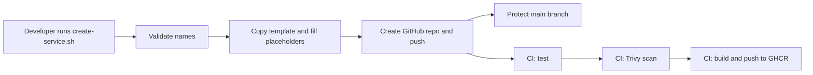

# Owo Lane Golden Path: New Node.js Service

One command creates a production-ready Node.js service, with CI/CD, security scanning, monitoring and documentation already in place.

**Before:** about 2 weeks to copy an old repo, strip it down, and wire up a pipeline.
**After:** about 2 minutes from command to a running, scanned image.

## Usage

```bash
./create-service.sh <service-name> <team>
./create-service.sh payments-api team-wallet
```

## What happens



## What every new service gets

| Area | Included |
|---|---|
| App | Express service with `/`, `/health` and `/metrics` |
| Tests | Jest and Supertest, run on every pull request and merge |
| CI/CD | Calls shared workflows from [ci-workflow-library](https://github.com/Thormie-Harshey/ci-workflow-library) |
| Security | Trivy scan (vulnerabilities, misconfigurations, secrets), non-root multi-stage image, locked dependencies, actions pinned to commit SHAs, branch protection on `main` |
| Monitoring | Prometheus metrics at `/metrics`, Docker health check on `/health` |
| Documentation | README with endpoints, run steps, pipeline and security notes |

## Prerequisites

- Git Bash or any bash shell
- GitHub CLI, logged in (`gh auth login`)

## Repository layout

```
create-service.sh   The golden path script
template/           The service template with placeholders
screenshots/        Evidence of an end-to-end run
```

## Example output

See [payments-api](https://github.com/Thormie-Harshey/payments-api), created by this script.
